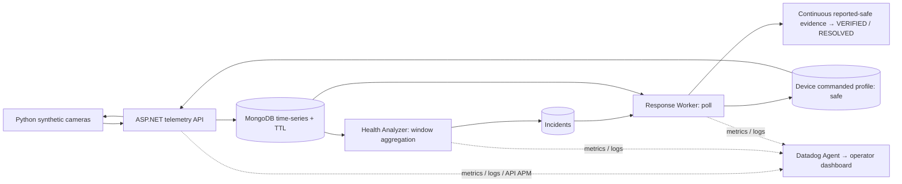

# EdgeGuard Ops · Signal404

**Monitoring detects the problem. EdgeGuard acts on it and verifies recovery.**

Thermal throttling can cut an edge AI camera's processing rate while its network still looks healthy. EdgeGuard detects the thermal pattern, automatically commands a safe processing profile, and waits for fresh, continuous healthy **reported-safe** telemetry before declaring recovery.

**Recorded automatic synthetic E2E:** `20261021202014` → incident **RESOLVED**, remediation **VERIFIED**, device **safe**; final captured sample **54.73°C / 18 FPS**. Detection → request **4.713 s**; detection → resolution **29.824 s**. These are single-run synthetic observations, not production benchmarks. Safe mode trades peak throughput for thermal headroom.

**Demo video:** `[HOSTED_VIDEO_URL — pending upload and access check]` · local final: `docs/video/edgeguard-ops-final-demo.mp4` (80.1 s, silent English captions).



**MongoDB** stores telemetry with retention, computes rolling trends with `$setWindowFields`, and persists devices, incidents, actions, and recovery evidence. **Datadog** displays metrics, searchable logs, monitor behavior and verified API APM. Application workers make the automated decisions; Datadog supplies the operator view.

## Review the submission

Deadline: **November 8, 2026, 23:59 ICT (UTC+7)**, confirmed on the [official submission form](https://docs.google.com/forms/d/e/1FAIpQLSd31MPvuUw_e2fZQFmMd-m_RrGyVSJJte_-5ctpAu_LRYap5A/viewform). Technical evaluation November 9–12; Top 8 November 13; online final November 15 (schedule supplied by team from organizer email).

| Resource | Purpose |
| --- | --- |
| [Automatic incident walkthrough](docs/submission/MUGVN2026_E2E_WALKTHROUGH.md) | Chronology, exact IDs, measurements and sources |
| [Submission overview](docs/SUBMISSION.md) | Technical story and honest scope |
| [Form answers](docs/submission/MUGVN2026_FORM_CONTENT.md) | Exact inspected form fields and prepared text |
| [Final checklist](docs/submission/MUGVN2026_FINAL_SUBMISSION_CHECKLIST.md) | Remaining human actions |
| [Judge Q&A](docs/submission/MUGVN2026_JUDGE_QA.md) | Design decisions and production limitations |
| [Release report](docs/submission/MUGVN2026_RELEASE_REPORT.md) | Checks, access, security and verdict |
| [Current editable PPTX](docs/presentation/EdgeGuard-Ops-Submission-20261106.pptx) | Eight-slide judge deck, automatic and staged evidence separated |
| [Current presentation content](docs/presentation/SLIDES.md) | Editable eight-slide content |
| [Architecture](docs/ARCHITECTURE.md) / [observability](docs/OBSERVABILITY.md) | Implementation and configuration |
| [Claim audit](docs/submission/MUGVN2026_CLAIM_AUDIT.md) | Claim → evidence → validity → correction |

The October 18 staged monitor ALERT→OK, October 21 run `20261021183352`, and automatic run `20261021202014` are separate evidence sets. Only telemetry-api APM is cloud-verified. All device telemetry is synthetic; there is no camera integration or application frontend.

## Run locally

Requirements: .NET **9** SDK (`global.json`), Python 3.11+, Docker with MongoDB 8. If `dotnet` selects another SDK, use your installed .NET 9 executable (on the development machine: `$env:USERPROFILE\.dotnet\dotnet.exe`).

From repository root:

```powershell
dotnet restore EdgeGuardOps.sln
dotnet build EdgeGuardOps.sln -c Release
docker compose config --quiet
docker compose up -d mongodb
dotnet test EdgeGuardOps.sln
python -m pytest apps/device-simulator -q
```

Open three terminals at repository root; use the same **new** database name in each to preserve existing demo data. Leave Datadog disabled for this local review.

```powershell
$env:MongoDb__DatabaseName = "edgeguard_review_20261106"
$env:Observability__DatadogEnabled = "false"
dotnet run --project services/telemetry-api
# Terminal 2: repeat environment settings, then:
# dotnet run --project services/health-analyzer
# Terminal 3: repeat environment settings, then:
# dotnet run --project services/response-worker
```

In a fourth terminal:

```powershell
cd apps/device-simulator
python -m pip install -r requirements.txt
$env:PYTHONPATH = "src"
$env:EDGEGUARD_TELEMETRY_URL = "http://localhost:5080"
$env:EDGEGUARD_DEVICE_COUNT = "1"
$env:EDGEGUARD_SCENARIO = "THERMAL_THROTTLE"
python -m edgeguard_simulator.main
```

Read-only inspection (replace database name if changed):

```powershell
Invoke-RestMethod http://localhost:5080/health
docker compose exec mongodb mongosh edgeguard_review_20261106 --quiet --eval 'db.incidents.find().sort({detectedAt:-1}).limit(1).forEach(printjson); db.remediation_actions.find().sort({requestedAt:-1}).limit(1).forEach(printjson); printjson(db.devices.findOne({_id:"edge-001"}));'
```

The existing `scripts/verify-e2e.ps1` and recording scripts drop live collections and stop services: **do not use them against preserved demo data**. The tests use randomly named `edgeguard_test_*` databases and clean up only those fixtures. Execution status and environment constraints are recorded in the release report; these instructions are not a claim that every command ran in this review.

Datadog setup: [OBSERVABILITY.md](docs/OBSERVABILITY.md). Keep API/app keys in local ignored `.env`; never put keys in form answers or judge materials. No new cloud infrastructure is required.

## Scope and disclosure

One analyzer and one response worker are the supported demo topology. Sequential retries are hardened; distributed exactly-once processing, authenticated device transport, durable recovery clocks, fleet-scale benchmarking and production rollout controls remain future work. Thermal vs network is a rule-based distinction, not a general root-cause classifier.

[AI and reuse disclosure](docs/AI_AND_REUSE_DISCLOSURE.md) · [Historical pre-hackathon baseline](docs/PRE_HACKATHON_BASELINE.md) · [Security](docs/SECURITY.md) · [Impact](docs/IMPACT.md)
