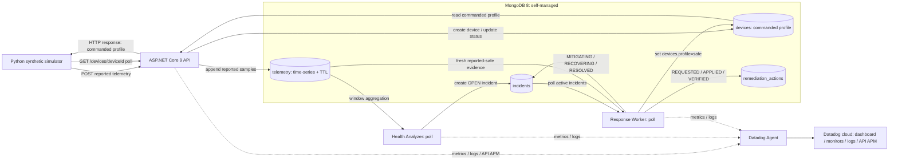

# Implemented architecture

Current implementation at `40ee9ee`, revalidated with isolated MongoDB on November 6, 2026. See [release validation](submission/MUGVN2026_RELEASE_VALIDATION.md) for complete E2E and real-persistence retry/failure checks. No architecture or product source changed during validation. The September scaffold is preserved separately in [PRE_HACKATHON_BASELINE.md](PRE_HACKATHON_BASELINE.md).

| Component | Actual behavior | Source |
| --- | --- | --- |
| Simulator | Posts synthetic samples; polls commanded profile and applies safe mode | `apps/device-simulator/src/edgeguard_simulator/` |
| API | Initializes MongoDB; health/ping, device lookup, ingest; returns HTTP 202 for accepted data | `services/telemetry-api/Program.cs` |
| MongoDB | Time-series with timestamp/metadata, seconds granularity, default 14-day TTL; devices, incidents, actions and indexes | `shared/EdgeGuard.Shared/Persistence/EdgeGuardMongoContext.cs` |
| Analyzer | Per-device trailing 1/5-minute averages; thermal thresholds and calm network; prevents a second active incident in sequential processing | `services/health-analyzer/FleetThermalHealthAnalyzer.cs` |
| Worker | OPEN → MITIGATING → RECOVERING → RESOLVED; actions REQUESTED → APPLIED → VERIFIED | `services/response-worker/SafeProfileRemediationExecutor.cs` |
| Datadog | DogStatsD, JSON file-tail logs, dashboard/monitors; profiler APM cloud-verified only for telemetry-api | `observability/datadog/`, [OBSERVABILITY.md](OBSERVABILITY.md) |

Detection accepts an absolute hot-temperature threshold or a rise vs trailing baseline, plus latency/FPS degradation and calm network. The short recorded run does not fill a five-minute baseline: do not describe its equal 1/5-minute averages as a measured long-baseline trend.

`devices.profile` is commanded state; `telemetry.profile` is reported state. Ingest updates an existing device's status with `$set` and does not replace its commanded profile. A command alone never resolves an incident. Recovery requires healthy reported-safe samples spanning the configured observation window (20 s default), GPU ≤75°C, latency ≤80 ms, FPS ≥18, at least 3 samples, latest age ≤5 s and inter-sample gaps ≤5 s. Stalls/gaps reset the in-memory observation clock; worker restart starts a new clock. Future-dated samples cannot prove recovery.

Sequential retry hardening uses a stable action ID per incident and preserves existing action records on duplicate insert. Action verification is written before incident resolution; missing/mismatched actions or failed verification writes leave the incident unresolved. There is no cross-document transaction: a crash can leave VERIFIED with RECOVERING until retry. No distributed lease or multi-worker exactly-once guarantee is claimed. Historical action IDs are unchanged.

MongoDB is self-managed via Compose, not Atlas. Workers poll; change streams are not used. API and workers have distinct processes and correlate by IDs, without a single propagated distributed trace. Default Compose starts MongoDB; `apps` and `datadog` are optional profiles. Host ports bind loopback. The lab API has no device authentication; do not expose it publicly.

Configuration uses .NET `Section__Key` variables. Datadog defaults disabled. See README for non-destructive local review and [walkthrough](submission/MUGVN2026_E2E_WALKTHROUGH.md) for exact evidence.

Diagram audit, November 7: all four collection names and the simulator HTTP request/response command flow are explicit. The API does not push commands to hardware; only the synthetic simulator applies the returned profile. Datadog is the operator view, not the decision engine. See [GitHub release audit](submission/MUGVN2026_GITHUB_AUDIT.md).
