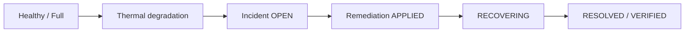

# One automatic incident: 20261021202014

All times below are **UTC, October 21, 2026** (ICT = UTC+7). This is one synthetic execution with workers already running, not a production benchmark.

Primary [snapshot](../evidence/e2e-verified-20261021202014.json): incident `inc-thermal-edge-001-20261021132057`; action `act-safe-edge-001-20261021132102`; device `edge-001`. The filename run ID uses local ICT; incident/action suffixes use UTC. Worker/analyzer log filenames retain their process start run `20261021200755`; correlate their individual messages by incident/action IDs and timestamps, not filename alone.

| Event | Timestamp UTC | Evidence |
| --- | --- | --- |
| Simulator start | 13:20:14.9871465 | Snapshot `simulator_started_utc` |
| Healthy reported + commanded full; 65.6°C / 29.2 FPS | 13:20:15.527913 | [Simulator log](../video/recordings/term-sim-20261021202014.log) |
| Degraded, reported full; GPU 85.2°C / 18.4 FPS | 13:20:30.862754 | Simulator log (rounded printed values) |
| OPEN / detection | 13:20:57.469 | Snapshot `incident.detectedAt`; analyzer log at 13:20:57.486593 |
| Remediation requested | 13:21:02.182 | Snapshot `remediation.requestedAt` |
| APPLIED; commanded safe | 13:21:02.1962198 | [Worker log](../video/recordings/term-worker-20261021200755.log) |
| RECOVERING | 13:21:07.2129666 | Same worker log; 20-second observation |
| Incident RESOLVED | 13:21:27.293 | Snapshot `resolvedAt`; worker confirms continuous healthy reported-safe evidence |
| Action VERIFIED completed | 13:21:27.297 | Snapshot `completedAt` |
| Captured recovered sample, safe/healthy | 13:21:30.432 | Snapshot: 54.73°C, 18 FPS, 60.9 ms |

Detection → request = **4.713 s**. Detection → resolution = **29.824 s**. These clocks use stored fields; requestedAt is not proof of hardware command acknowledgement. The historical run wrote RESOLVED four milliseconds before VERIFIED; new code verifies the action first to make failure handling safer. Original evidence remains unchanged.

| Judge question | What actually happened |
| --- | --- |
| Action | Worker set `devices.profile=safe`; simulator fetched and reported that profile |
| Required evidence | Fresh, continuous healthy reported-safe samples, including GPU/latency/FPS thresholds |
| Why wait? | A successful command write proves intent; it does not prove cooling or that the device applied it |
| MongoDB record | Timestamped telemetry, commanded device state, incident/action IDs and terminal states |
| Datadog display | Paused historical graphs and correlated incident logs for this run; live “now” widgets are masked/labeled in the edit |

**18 FPS is the intended synthetic thermal safe-mode operating point.** Full mode begins near 29 FPS; reducing workload restores thermal headroom and acceptable latency at reduced throughput. This is not full-performance restoration or measured physical-camera cooling.

The analyzer log records GPU 1-minute average 85.31°C, latency 137.07 ms, FPS 17.28, packet loss 0.162%, network latency 9.97 ms. These are aggregates, not the snapshot's final sample. The 1/5-minute GPU averages are equal in this short startup run; the absolute threshold path triggers detection.

Datadog capture provenance: [capture metadata](../video/recordings/datadog-capture-meta.json), paused epoch window `1792588794987`–`1792588991949`, captured at 13:34:51 UTC. This covers the recorded event, not the later capture wall clock. It does **not** prove monitor ALERT→OK in this execution. That monitor transition belongs to the separately documented [October 18 staged run](../evidence/live-datadog-validation.json). [Run 20261021183352](../evidence/e2e-verified-20261021183352.json) is also separate.

The final video is an editorial sequence: Inject already includes safe telemetry before Detect returns to the historical graph. Respond uses held console transcript replay frames (messages corroborated by raw worker JSON logs; replay script `conhost-worker-respond.ps1`); Verify holds a MongoDB query showing a later safe sample (not the 13:21:30 snapshot). These edits compress time; they are not a continuous real-time capture.
